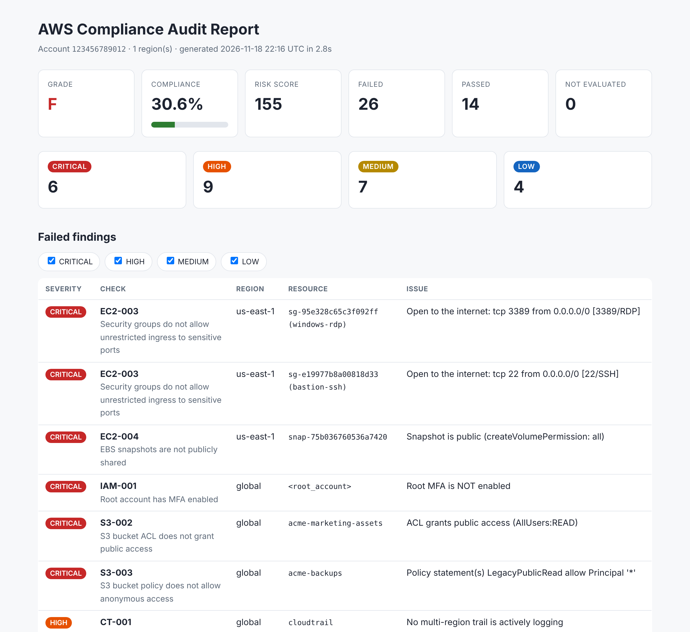

# AWS Compliance Auditor

[](https://github.com/DaveyD347/aws-compliance-auditor/actions/workflows/ci.yml)


A read-only Python tool that audits an AWS account against a security baseline (public S3 buckets,
unencrypted EBS volumes, security groups open to the internet, IAM hygiene, CloudTrail, RDS exposure)
and produces a scored **Markdown, HTML and JSON** compliance report.

It's built for the "quick look at a new account" and "run it every Monday in CI" use cases: one command,
no infrastructure, read-only permissions, and an exit code you can gate a pipeline on.



See a full example: [Markdown](examples/sample-report.md) · [JSON](examples/sample-report.json) ·
[HTML](examples/sample-report.html) (download and open it), generated from a deliberately misconfigured
mocked account by [`examples/demo.py`](examples/demo.py).

## Features

- **20 checks** across S3, EC2/EBS/VPC, IAM, CloudTrail and RDS, mapped to CIS AWS Foundations controls
- **All enabled regions** discovered automatically and scanned concurrently; global services run once
- **Pagination everywhere**, adaptive retries for throttling, and per-check error isolation: a missing
  permission becomes a "not evaluated" row in the report instead of a crash
- **Risk scoring**: severity-weighted compliance %, a raw risk score for trending, and a letter grade that
  can't be better than C while any CRITICAL finding is open
- **Reports** in Markdown (drops straight into a GitHub job summary), self-contained HTML with severity
  filters and dark mode, and JSON for pipelines
- **CI-friendly**: `--fail-on high` exits non-zero when findings at or above a severity exist
- **Tested without AWS**: 40 tests, ~96% coverage, all against [moto](https://github.com/getmoto/moto)

## Quick start

```bash
git clone https://github.com/DaveyD347/aws-compliance-auditor.git
cd aws-compliance-auditor
pip install .

aws-audit --profile my-readonly-profile
```

```
Account 123456789012 · 17 region(s) · 20 checks
Grade F · compliance 30.6% · risk score 155
14 passed, 26 failed, 0 not evaluated

  CRITICAL EC2-003  us-east-1      sg-0b16826a10e33300f (windows-rdp): Open to the internet: tcp 3389 from 0.0.0.0/0 [3389/RDP]
  CRITICAL EC2-004  us-east-1      snap-67053a5b1f8b5b8f0: Snapshot is public (createVolumePermission: all)
  CRITICAL IAM-001  global         <root_account>: Root MFA is NOT enabled
  CRITICAL S3-002   global         acme-marketing-assets: ACL grants public access (AllUsers:READ)
  ...
Report written: reports/compliance-report-123456789012-20261118T221518Z.md
Report written: reports/compliance-report-123456789012-20261118T221518Z.html
```

Try it with no AWS account at all:

```bash
pip install -e ".[dev]"
python examples/demo.py
```

## Usage

```
aws-audit [--profile NAME] [--regions us-east-1,eu-west-1] [--services s3,iam]
          [--checks S3-001,EC2-003] [--exclude S3-005] [--format md,html,json]
          [--output-dir reports] [--min-severity low] [--fail-on high]
          [--workers 16] [--list-checks] [-v]
```

| Option | Description |
|---|---|
| `--profile` | AWS named profile. Otherwise the standard credential chain is used (env vars, SSO, instance role...). |
| `--regions` | Regions to scan. Default: every region enabled for the account. |
| `--services` / `--checks` / `--exclude` | Narrow down which rules run. |
| `--format` | Any of `md`, `html`, `json`. Default `md,html`. |
| `--min-severity` | Hide failures below this severity from the report. |
| `--fail-on` | Exit `1` if any failure at or above this severity exists. |
| `--list-checks` | Print the baseline and exit. |

Exit codes: `0` success, `1` findings at or above `--fail-on`, `2` usage or credential error.

## Checks

| ID | Severity | Check | Reference |
|---|---|---|---|
| S3-001 | HIGH | Block Public Access fully enabled on each bucket | CIS 2.1.4 |
| S3-002 | CRITICAL | Bucket ACL does not grant `AllUsers` / `AuthenticatedUsers` | CIS 2.1.4 |
| S3-003 | CRITICAL | Bucket policy has no unconditioned `Principal: "*"` allow | |
| S3-004 | MEDIUM | Default bucket encryption configured | CIS 2.1.1 |
| S3-005 | LOW | Versioning enabled | |
| EC2-001 | HIGH | EBS volumes encrypted | CIS 2.2.1 |
| EC2-002 | MEDIUM | EBS encryption-by-default enabled (per region) | CIS 2.2.1 |
| EC2-003 | CRITICAL* | No `0.0.0.0/0` / `::/0` ingress to SSH, RDP, databases or all ports | CIS 5.2, 5.3 |
| EC2-004 | CRITICAL | No publicly shared EBS snapshots | |
| EC2-005 | MEDIUM | Instances require IMDSv2 | CIS 5.6 |
| IAM-001 | CRITICAL | Root account MFA enabled | CIS 1.5 |
| IAM-002 | CRITICAL | No root access keys | CIS 1.4 |
| IAM-003 | HIGH | Console users have MFA | CIS 1.10 |
| IAM-004 | MEDIUM | Active access keys rotated within 90 days | CIS 1.14 |
| IAM-005 | MEDIUM | Password policy: length ≥ 14, reuse prevention ≥ 24 | CIS 1.8, 1.9 |
| IAM-006 | HIGH | No attached customer-managed policy grants `*:*` | CIS 1.16 |
| CT-001 | HIGH | A multi-region CloudTrail trail is actively logging | CIS 3.1 |
| CT-002 | LOW | CloudTrail log file validation enabled | CIS 3.2 |
| RDS-001 | HIGH | RDS instances not publicly accessible | CIS 2.3.3 |
| RDS-002 | HIGH | RDS storage encrypted | CIS 2.3.1 |

\* EC2-003 grades each exposure: sensitive ports or all traffic are CRITICAL, port ranges of 1000+ are HIGH,
other ports MEDIUM, and public 80/443 is treated as normal web traffic.

## Scoring

- **Compliance %**: each check contributes its severity weight (CRITICAL 10, HIGH 7, MEDIUM 4, LOW 1), scaled
  by the share of its resources that pass. Scoring per check, not per resource, keeps 2,000 passing
  snapshots from hiding one failing root-MFA control.
- **Risk score**: sum of severity weights of every failed resource. Unbounded; useful to track over time.
- **Grade**: A ≥ 90, B ≥ 80, C ≥ 70, D ≥ 60, else F, and capped at C while any CRITICAL failure is open.

## Permissions

The tool only makes read calls. Use the AWS-managed `SecurityAudit` policy, or the least-privilege policy in
[`docs/iam-policy.json`](docs/iam-policy.json). Checks the credentials can't run show up as
"not evaluated" in the report rather than failing the audit.

## Run it on a schedule with GitHub Actions

[`examples/scheduled-audit.yml`](examples/scheduled-audit.yml) runs the audit every Monday using GitHub
OIDC (no stored AWS keys), writes the Markdown report to the job summary, uploads all reports as an
artifact and fails the run when a CRITICAL finding appears.

## Project layout

```
src/aws_auditor/
  checks/        one module per service; each rule is a small registered class
  clients.py     thread-safe boto3 client cache with adaptive retries
  scanner.py     fans checks out across regions with a thread pool
  scoring.py     compliance %, risk score, grade
  report.py      Markdown / HTML (Jinja2, autoescaped) / JSON renderers
  cli.py         aws-audit entry point
tests/           moto-backed tests for every check, the scanner, reports and CLI
```

## Contributing

New checks are a single class plus a test. See [CONTRIBUTING.md](CONTRIBUTING.md).

## Disclaimer

Run this only against accounts you own or are authorised to assess. A clean report means these 20 controls
pass; it is not a full security assessment.

## License

[MIT](LICENSE)
